<p align="center">
  
</p>

<h1 align="center">🎀 Happy Birthday</h1>

<p align="center">
  A little corner of the internet, made with love.
  <br />
  An interactive birthday experience filled with heartfelt letters, little surprises, memories, and scrapbook details.
</p>

<p align="center">
  <a href="https://happy-birthday-preview.vercel.app/">Live Demo</a>
  &nbsp;·&nbsp;
  <a href="https://github.com/Munna-Scriptz/Happy-Birthday">Source Code</a>
  &nbsp;·&nbsp;
  <a href="https://github.com/Munna-Scriptz/Happy-Birthday/issues">Report an Issue</a>
</p>

<p align="center">
  
  
  
  
</p>

---

## 🌷 A little preview

The project is designed like a digital birthday scrapbook — with soft colours, playful details, and small interactions to make every page feel personal.

<table align="center" width="100%" border="0" cellpadding="8" cellspacing="0">
  <tr>
    <td width="50%" align="center">
      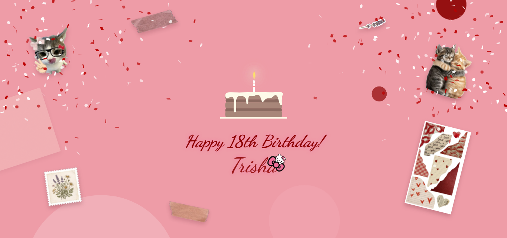
      <br />
      <sub><strong>01 · The birthday experience</strong></sub>
    </td>
    <td width="50%" align="center">
      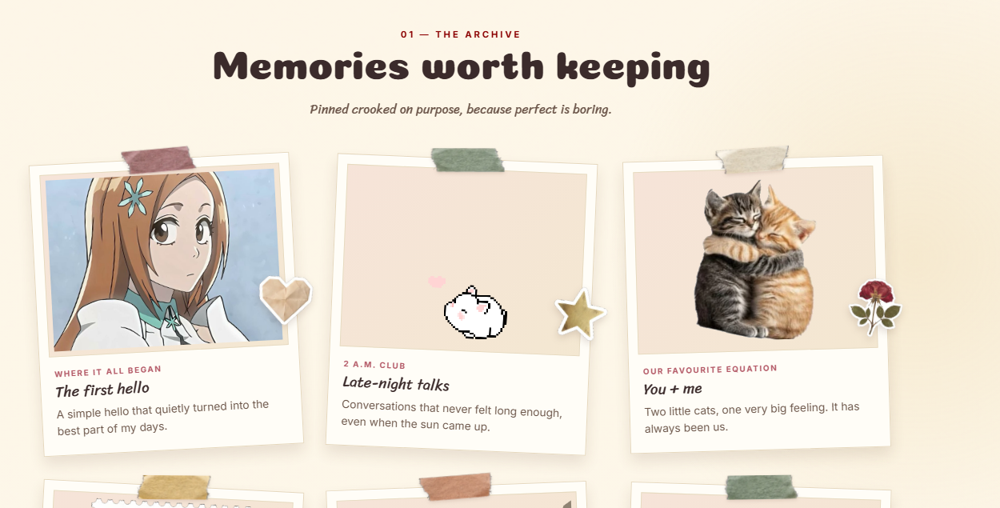
      <br />
      <sub><strong>02 · Letters and surprises</strong></sub>
    </td>
  </tr>
  <tr>
    <td width="50%" align="center">
      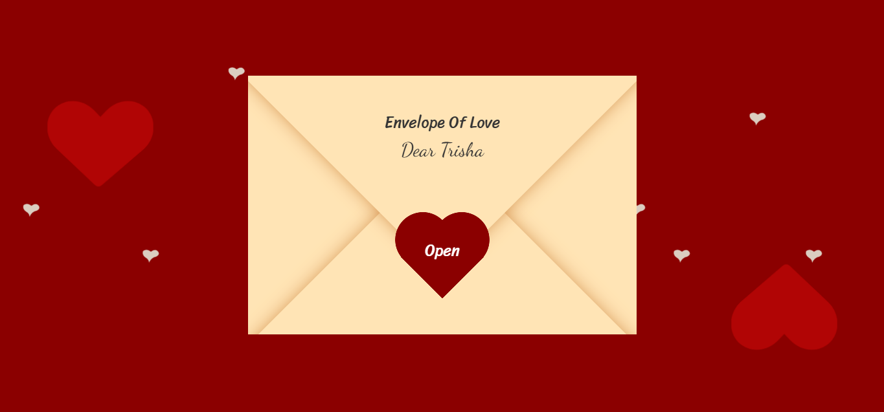
      <br />
      <sub><strong>03 · Little memories</strong></sub>
    </td>
    <td width="50%" align="center">
      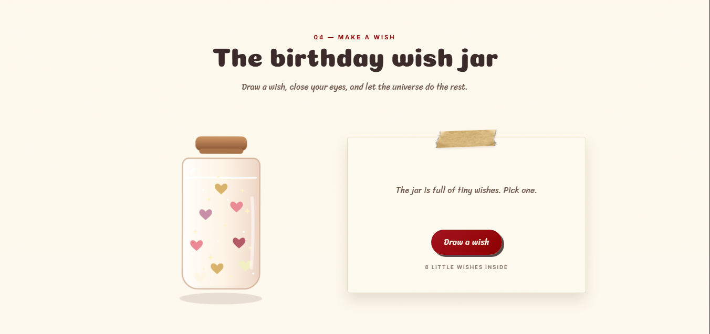
      <br />
      <sub><strong>04 · The scrapbook</strong></sub>
    </td>
  </tr>
</table>

---

## 💗 What's inside?

<table width="100%" border="0" cellpadding="12" cellspacing="8">
  <tr>
    <td width="50%" valign="top" bgcolor="#fff1f5">
      <strong>🎂 A sweet welcome</strong><br />
      A custom SVG cake-opening animation, confetti, and a birthday homepage to set the mood.
    </td>
    <td width="50%" valign="top" bgcolor="#fff1f5">
      <strong>💌 Heartfelt letters</strong><br />
      A sealed envelope that reveals a personal message, plus a notebook-inspired 3D fold-out letter.
    </td>
  </tr>
  <tr>
    <td width="50%" valign="top" bgcolor="#fff1f5">
      <strong>📝 Love notes</strong><br />
      Little notes that can be dragged around the screen and explored.
    </td>
    <td width="50%" valign="top" bgcolor="#fff1f5">
      <strong>📸 A memory scrapbook</strong><br />
      Photos, a timeline, reason cards, and a wish jar — decorated with playful stickers.
    </td>
  </tr>
  <tr>
    <td width="50%" valign="top" bgcolor="#fff1f5">
      <strong>✨ Smooth interactions</strong><br />
      Hand-drawn page transitions, subtle animations, and thoughtful little details throughout.
    </td>
    <td width="50%" valign="top" bgcolor="#fff1f5">
      <strong>📱 Responsive by design</strong><br />
      Layouts, typography, and the notebook experience adapt to smaller phone screens.
    </td>
  </tr>
</table>

## 🧭 The pages

| Page | What you'll find |
| --- | --- |
| **Homepage** | Birthday greeting, animated date, portrait, balloons, and the main ways to explore. |
| **Little Letter** | A sealed envelope that opens to reveal a personal message. Tap outside it or press `Esc` to close it. |
| **3D Letter** | A notebook-style fold-out letter with ruled paper, binder rings, and a cover photo. |
| **Love Notes** | Floating notes that visitors can drag around the screen. |
| **Scrapbook** | Memories, a timeline, reason cards, and a jar full of wishes. |

---

## 🚀 Run it locally

You'll need [Node.js](https://nodejs.org/) and npm installed.

**1. Clone the repository**

```bash
git clone https://github.com/Munna-Scriptz/Happy-Birthday.git
```

**2. Move into the project and install dependencies**

```bash
cd Happy-Birthday
npm install
```

**3. Start the development server**

```bash
npm run dev
```

Open the local URL printed in your terminal to see the website.

**4. Create a production build**

```bash
npm run build
```

---

## 🎨 Make it yours

The project is designed to be personalized. Most of the birthday content is kept in one place:

- **`src/data/siteData.js`** — update the names, age, birthday date, photos, letters, love notes, and scrapbook content.
- **`public/stickers/`** — find the scrapbook stickers, paper textures, and decorative tape. Replace an image while keeping its filename if you want to preserve the existing references.
- **`src/pages/Home.jsx`** — adjust homepage presentation and the timing of its animations.

You can replace the sample content with your own photos and messages, then make the colours and details your own.

### 🎀 Sticker collection

The little decorations used throughout the scrapbook live in `public/stickers/`.

<p align="center"><strong>Little characters &amp; stickers</strong></p>

<p align="center">
  
  &nbsp;&nbsp;
  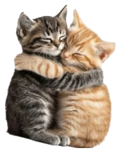
  &nbsp;&nbsp;
  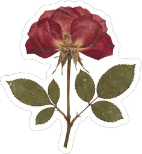
  &nbsp;&nbsp;
  
  &nbsp;&nbsp;
  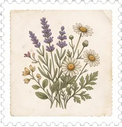
  &nbsp;&nbsp;
  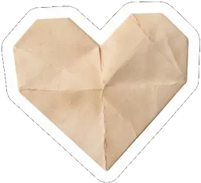
  &nbsp;&nbsp;
  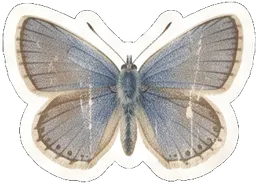
  &nbsp;&nbsp;
  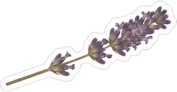
</p>

<p align="center"><strong>Paper textures</strong></p>

<p align="center">
  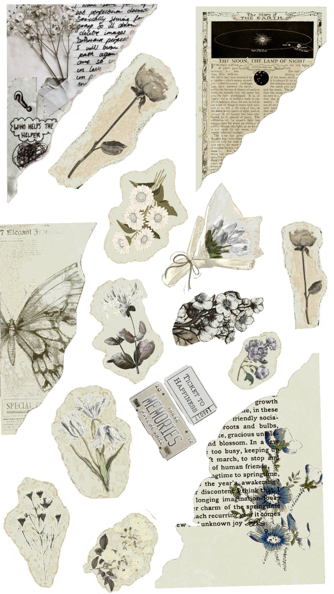
  &nbsp;&nbsp;
  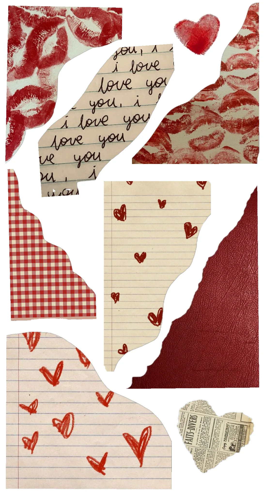
  &nbsp;&nbsp;
  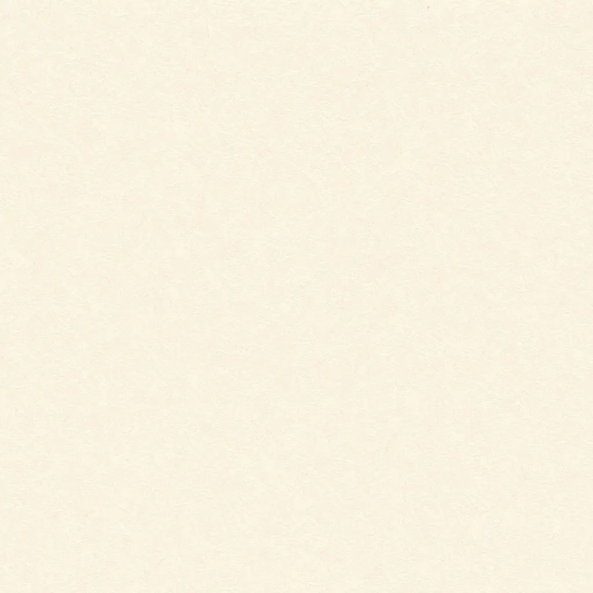
  &nbsp;&nbsp;
  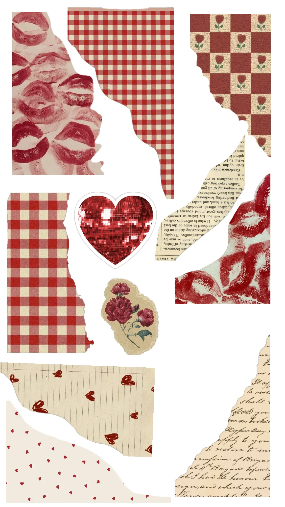
</p>

<p align="center"><strong>Decorative tape</strong></p>

<p align="center">
  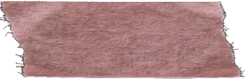
  &nbsp;
  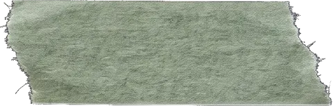
  &nbsp;
  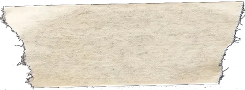
  &nbsp;
  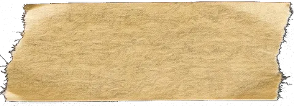
  &nbsp;
  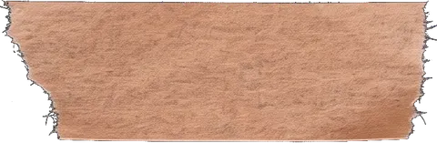
  &nbsp;
  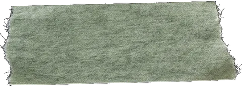
  &nbsp;
  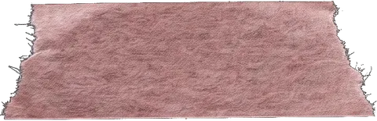
</p>

---

## 🛠️ Built with

<p>
  
  
  
  
  
</p>

## 🌸 Why I made it

I wanted to build something more personal than a regular birthday card — a small interactive experience where animations, letters, photos, and scrapbook details come together to make someone feel special.

Feel free to explore the code, personalize it for someone you care about, or build on top of it. I hope it gives you a little inspiration for your next creative project.

---

<p align="center">
  
</p>

<h2 align="center">💖 Like this project?</h2>

<p align="center">
  If this little birthday project made you smile or helped you create something special,
  <br />
  please consider giving the repository a ⭐ star on GitHub. It means a lot and helps others discover it!
</p>

<p align="center">
  <a href="https://github.com/Munna-Scriptz/Happy-Birthday/stargazers"><strong>⭐ Give this project a star</strong></a>
</p>

<p align="center">
  Made with love &amp; a little bit of pink magic by <a href="https://github.com/Munna-Scriptz">Munna-Scriptz</a> ♡
</p>